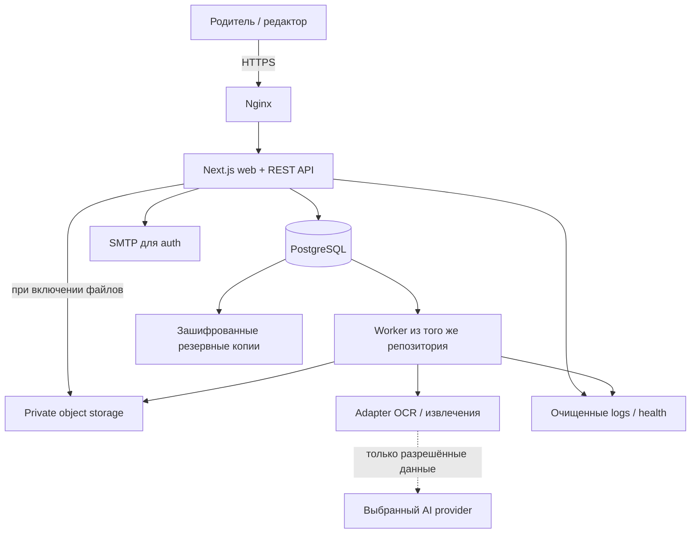
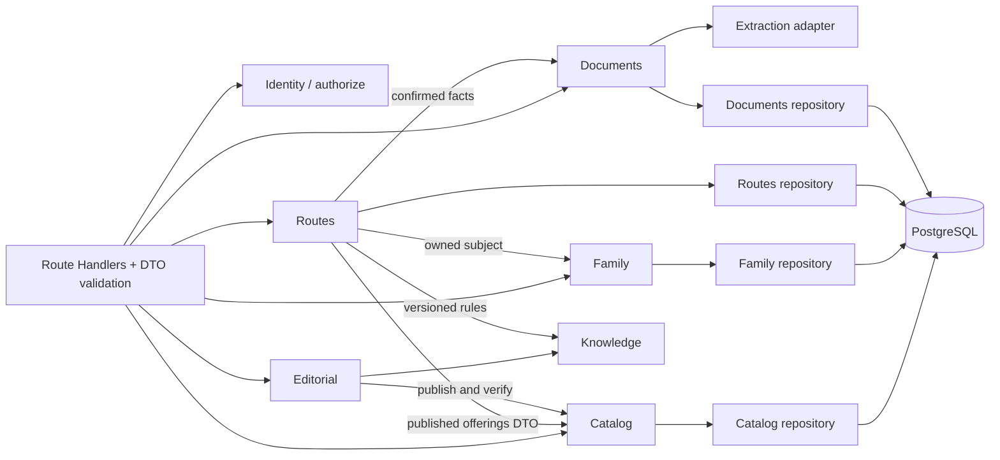
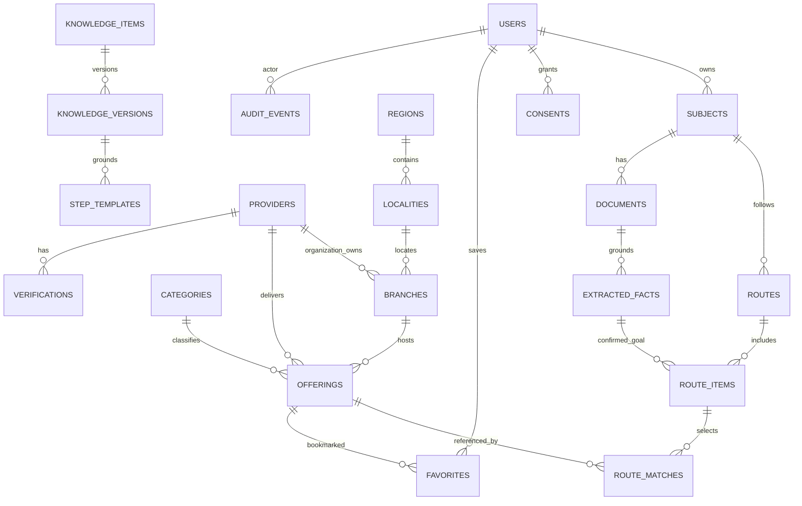
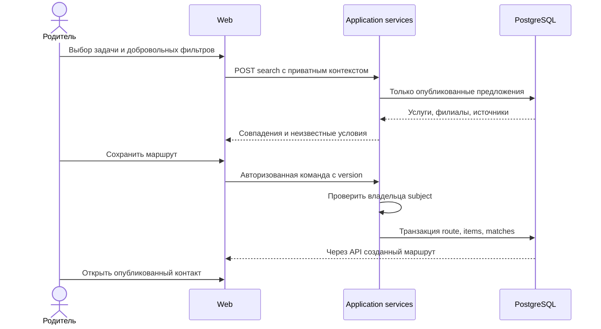

# Architecture Design Document

## «Маршрут семьи»

Версия 1.1 • 11 ноября 2026 • статус Proposed.

Документ задаёт архитектуру демо за три дня и следующего ограниченного пилота. Стек предложен по просьбе заказчика. Один разработчик, второй участник отвечает за маркетинг и выступление. География продукта — Казахстан, первая проверка локальных карточек — Алматы.

Три дня — срок демонстрации. Готовность пилота определяется проверками доступа, восстановления, обработки данных и актуальности каталога. Оценки скорости и ресурсов ниже являются проектными ориентирами, которые проверяются измерениями.

## 0. Principal architecture review

Версия 1.1 сохраняет основу и главы v1.0. Приоритет заказчика — каталог, персональный маршрут, AI-разбор и подтверждение. MVP означает учебную демонстрацию за три дня. Pilot — многопользовательский запуск. Последующие уточнения в 5.5 и главе 7 являются частью модели, а не альтернативными вариантами реализации.

| ID / Priority | Текущая проблема v1.0 | Почему важна | Исправление |
|---|---|---|---|
| R01 High | AI optional и готовый ответ достаточен | Новое ядро требует AI processing | Один живой вызов на учебном PDF обязателен, fixture только обозначенный fallback |
| R02 High | Восемь модулей с тремя слоями | Избыточная работа для одного разработчика | Три feature-папки и service/repository по необходимости |
| R03 High | Knowledge engine, отзывы, PDF и кабинеты перемешаны с ядром | Не укладываются в три дня | Матрица scope ниже |
| R04 Critical | Разные owner в route/document допускаются схемой | Возможна привязка чужого документа | Составные FK и транзакционная проверка всей цепочки |
| R05 High | kind организации нельзя проверить обычным CHECK другой таблицы | Неверные филиалы | FK плюс constraint trigger на insert/update связи и смену kind |
| R06 High | Нет подтверждённой связи специалиста с филиалом | Карточка обещает неверное место | offering_locations с composite FK |
| R07 High | PK matches хранит текущую подборку, текст обещает новые снимки | История не реализуема данной схемой | Пересчёт заменяет текущие matches атомарно, историю перенести в Future |
| R08 Critical | Не определено удаление производных целей | Чувствительные данные остаются после удаления файла | Purge document-derived items, matches, facts, runs и объекта |
| R09 High | Разные idempotency constraints в схеме и тексте | Дубликаты и конкурентные результаты | Scoped key, request hash, один активный run |
| R10 High | Нет JSON contracts и частичных результатов | Команда заново проектировала бы интеграцию | Контракты и ошибки в главе 7 |
| R11 High | Document/run имеют дублирующие статусы | Несогласованная готовность UI | Lifecycle файла отдельно, состояние вычисления только в run |
| R12 High | Поздний AI-ответ может вернуть удалённые данные | Нарушение удаления | generation check под блокировкой и отмена результата |
| R13 High | Cache может сохранить открытый набор после истечения срока | Устаревшая информация | Dynamic no-store для search/card и private данных |
| R14 High | Срок зависит от timezone пользователя, выбран Qyzylorda для Алматы | Путешествие меняет статус позиции | Asia/Almaty для дат РК, UTC для событий, зона источника отдельно |
| R15 Medium | Старение age snapshot не определено | Ошибка у возрастной границы | Возраст на дату, approximate flag и уточнение |
| R16 High | SMTP, storage, cron и worker выглядят частью демо | Избыточная инфраструктура | MVP один web process, Pilot durable processing |
| R17 High | Журнал удаления может откатиться с backup БД | Restore возвращает стёртые сведения | Независимая копия tombstones, replay до открытия трафика |
| R18 High | Принятие фактов не описано атомарно | Повтор/частичное добавление целей | Confirm endpoint с versions и одной транзакцией |
| R19 Medium | SLO и VM выбраны без данных о нагрузке | Ложная уверенность в мощности | Сохранены как измеряемые ориентиры |
| R20 High | Retention исходников и extraction не определён | Нельзя проверить удаление | Согласованный retention конфиг и уборка до Pilot |
| R21 Medium | Исправление может выглядеть как цитата документа | Ошибочная атрибуция | origin=user_correction, неизменный source quote |
| R22 Low | Перевод и источник могут смешиваться | Ошибки смысла | Помеченный языковой fallback, locale не меняет дату и qualification |

Critical закрываются до реальных данных. High — до соответствующего сценария поставки.

### 0.1 Scope компонентов

| Компонент | Must Have for MVP | Must Have for Pilot | Future Improvements |
|---|---|---|---|
| Каталог | Fixtures, фильтры, карточки, источник | PostgreSQL, ручное обновление published записей | Встроенная карта, расширение данных регионов |
| Маршрут | Цели, подбор, статусы, память вкладки | Owner, сохранение, concurrency, удаление | История пересчётов, совместные опекуны |
| AI | Учебный text-PDF, живое извлечение, подтверждение, ошибки | Private upload, durable jobs, аудит условий обработки | OCR, изображения, большие документы |
| Auth | Изолированная учебная вкладка | Better Auth, восстановление, staff protection | SMS/OIDC по спросу |
| Контент | Категории помощи взрослому, проверенные ссылки | Ручная редактура | Knowledge rules engine, курсы, сообщество |
| Инфраструктура | Один Node web process | TLS, PostgreSQL, worker для реальных файлов, backup/restore | Реплики, Redis, централизованные метрики |
| Избранное, отзывы, экспорт, self-service | Вне основного пути | Отдельные задачи после ядра | Расширенный кабинет, рейтинги и PDF |

Исходные требования остаются в backlog. Дополнительные каталоги и сервисы из исследования не становятся обязательными компонентами.

## 1. Основания и границы решения

Изучены заметки интервью 06.11.2026, исходное ТЗ версии 0.1, spravka-marshrut-demo.pdf и подготовленный в этом чате исследовательский разбор «Маршрут семьи — концепция и план хакатона».

Исходное ТЗ предполагает онбординг, профиль ребёнка, поиск списком и на карте, фильтры, избранное, карточки, отзывы, чек-лист и регистрацию специалистов. Его второй этап включает сообщество, поддержку родителей, заполняемость и кабинет поставщика. Демо справки добавляет отдельный запрос взрослого, источники сведений, подтверждение извлечённых полей, средства реабилитации и PDF.

Исследование предложило начать с конкретной задачи семьи, доступного с первого экрана поиска помощи взрослому и небольшого проверенного каталога. Это продуктовые рекомендации для проверки. Они не превращают все исследованные возможности в обязательства первого релиза.

### 1.1 Бизнес-логика

1. Семья выбирает, кому требуется помощь, город и задачу.
2. Необязательные сведения о возрасте, языке, районе и доступности уточняют поиск.
3. Подтверждённая цель из документа может стать поисковым фильтром.
4. Каталог возвращает предложения конкретных услуг с профессионалом, филиалом, условиями приёма и источником.
5. Родитель сравнивает варианты, сохраняет выбор и связывается по опубликованному контакту.
6. Маршрут хранит цель, основание, действия и отметки выполнения.
7. Модератор публикует сведения и фиксирует, что проверено, кем и когда.

Результат контакта фиксируется только со слов семьи или организации. Клик по телефону означает открытие контакта. Он не доказывает запись или оказание помощи.

### 1.2 Версии продукта

Поставка определена матрицей 0.1. Для MVP обязательна успешная живая AI-обработка учебного документа. Реальные документы принимаются только в Pilot с проверкой доступа, удаления и условий внешнего обработчика. Неподтверждённые факты отображаются пользователю и не создают действия маршрута.

### 1.3 Нефункциональные требования

Обоснованы материалами: приватность диагноза, согласие на обработку, удаление данных, крупные элементы и короткие тексты, пропускаемые поля анкеты, многоязычность, проверка документов и отзывов, актуальность официальной информации.

Предлагаемые инженерные цели для пилота, требующие согласования:

| Показатель | Начальная цель и метод проверки |
|---|---|
| Обычный поиск | p95 до 700 мс на сервере при 10 RPS, 10 тыс. предложений, без OCR/ИИ |
| Мобильный экран | Работает на ширине 360 px, клавиатура и screen reader сохраняют доступ к действиям |
| Восстановление | RPO до 24 ч, RTO до 4 ч, проверка восстановления до приёма реальных данных |
| Обработка ошибки ИИ | Ручной поиск и сохранённые маршруты доступны |
| База | Транзакционные изменения, миграции в репозитории, резервные копии |
| Изоляция | Семья A не может прочитать/изменить объект семьи B через любой endpoint |

Реальная нагрузка, бюджет, требования к доступности и срокам хранения в исследовании отсутствуют. Национальная география сама по себе не требует распределённой системы.

## 2. Сравнение архитектур

| Подход | Разработка и MVP | Производительность | Масштабирование | Инфраструктура | Поддержка |
|---|---|---|---|---|---|
| Обычный монолит | Самый быстрый старт | Локальные вызовы, простые транзакции | Реплики приложения и увеличение БД | Минимальная | При смешении логики быстро дорожает |
| **Модульный монолит** | Немного дисциплины при близкой скорости | Те же преимущества монолита | Реплики, отдельный worker, последующее выделение нагрузки | Низкая | Ясные границы и единые контракты |
| Микросервисы | Несколько развёртываний, auth между сервисами, согласование данных | Добавляются сеть и частичные отказы | Независимое масштабирование | Высокая | Требует больше эксплуатационной работы |
| SPA + отдельный API | Два приложения и сборки | Подходит для интерактивного интерфейса | Независимые frontend/backend | Низкая или средняя | Оправдано при нескольких клиентах или разных командах |
| Managed BaaS | Быстрый CRUD и auth | Зависит от запросов и провайдера | По возможностям платформы | Низкая на старте | Нужна проверка региона хранения, правил доступа и переноса |

**Выбран модульный монолит на Next.js с PostgreSQL.** Веб-интерфейс и REST API развёртываются одним приложением. Три feature-папки содержат service-функции и репозитории по мере появления постоянного хранения. Тяжёлая обработка запускается отдельным процессом того же репозитория при её включении. Общая БД позволяет атомарно сохранять документ, задание и его статус.

Микросервисы можно рассмотреть при измеренной необходимости независимо масштабировать обработку документов или при появлении нескольких автономных команд. Сначала достаточно выделить worker с существующими контрактами.

## 3. Technology Stack

| Область | Выбор | Причина | Альтернатива |
|---|---|---|---|
| Язык | TypeScript с strict mode | Один язык для UI, API и схем валидации | Python/Django при наличии соответствующего опыта |
| Frontend | React + Next.js App Router, CSS Modules | Каталог, страницы карточек, серверное выполнение и API в одной поставке | Vite React + Fastify, два приложения |
| Backend | Node.js LTS, Next.js Route Handlers | Небольшой HTTP API, одна команда и один deploy | Django для сильной встроенной админки, NestJS при более крупной серверной команде |
| Данные | PostgreSQL | Связи, FK, транзакции, фильтры, очередь заданий при необходимости | SQLite для локального макета, но отдельная миграция к многопользовательскому пилоту |
| Доступ к БД | Drizzle ORM + SQL migrations, node-postgres | Явный SQL, транзакции и индексы, типы TypeScript | Prisma или прямой SQL |
| API | REST /api/v1, OpenAPI 3.1, Zod | Проверяемые DTO и доступный будущему клиенту контракт | tRPC для исключительно TS-клиентов, GraphQL при реальной потребности в гибких агрегатах |
| Auth пилота | Better Auth, email/password, подтверждение email и восстановление | Самостоятельное размещение сессий, готовые механизмы auth | OIDC-провайдер, SMS при подтверждённой необходимости и бюджете |
| UI-состояние | URL для публичных фильтров, React state для формы | Воспроизводимый публичный поиск, простая модель | TanStack Query при появлении сложной клиентской синхронизации |
| Локализация | Словари ru/kk, явный locale URL | Два языка уже заложены в материалах | next-intl при росте переводов |
| Файлы пилота | Private S3-compatible storage в выбранном регионе РК | Независимость файлов от web-контейнера | Закрытый persistent volume для малого пилота с проверенными backup |
| Cache | Dynamic no-store для поиска, карточек и private ответов, cache static assets | Небольшой каталог обслуживается PostgreSQL | Redis после измерения повторных дорогих запросов |
| Background | MVP — ограниченный синхронный запрос, Pilot — Graphile Worker и его crontab для уборки | Очередь в имеющейся PostgreSQL, retries | BullMQ + Redis при отдельной подтверждённой необходимости Redis |
| Deploy | Docker Compose, Linux VPS, Nginx TLS | Понятная и переносимая поставка | Managed containers при подходящем регионе и бюджете |
| Мониторинг | JSON logs через Pino, request ID, health/readiness, внешняя проверка uptime | Диагностика ошибок и доступности малого пилота | OpenTelemetry и централизованные метрики при росте |
| Тесты | Vitest, интеграции с настоящей PostgreSQL, Playwright | Правила подбора, изоляция данных, пользовательский путь | Jest, pytest для Python-стека |

Фиксировать совместимые стабильные версии и lockfile при setup. Конкретные major-версии здесь не являются требованием продукта. Обновления безопасности проверяются перед пилотом.

Официальные основания: [Next.js self-hosting](https://nextjs.org/docs/app/guides/self-hosting), [Route Handlers как backend](https://nextjs.org/docs/app/guides/backend-for-frontend), [проверки доступа](https://nextjs.org/docs/app/guides/authentication), [Drizzle migrations](https://orm.drizzle.team/docs/migrations), [Better Auth sessions](https://better-auth.com/docs/concepts/session-management), [Graphile Worker delivery](https://worker.graphile.org/docs).

## 4. High-Level Architecture

Диаграмма ниже — целевой Pilot с файлами. MVP содержит браузер, один Next.js process, fixtures и один AI adapter. PostgreSQL/storage/worker/SMTP добавляются при переходе к Pilot.



В MVP работают web/API, fixtures и живой AI на учебном PDF. PostgreSQL обязателен при переходе к Pilot. Auth, SMTP, storage и worker включаются для соответствующих пилотных сценариев. Браузер обращается к приложению на одном origin. БД и worker не доступны публично.

### 4.1 Component Diagram



Для MVP достаточно feature-папок catalog, routes, documents с contracts.ts и service.ts. Repository добавляется при подмене fixtures на PostgreSQL. Пустые domain/application/infrastructure директории не создаются. Диаграмма 4.1 показывает логические обязанности, а Identity/Editorial/Knowledge не требуют самостоятельных пакетов. UI не импортирует таблицы БД. Route Handler валидирует запрос, разрешение и вызывает application service. Сервисы могут использовать чужие public contracts. Запись в чужие таблицы выполняется через owning module. Shared содержит техническую инфраструктуру, а не бизнес-правила.

### 4.2 Основные модули

| Модуль | Ответственность |
|---|---|
| Identity | Пользователь, сессии, проверка роли и принадлежности объекта |
| Family | Принадлежащие пользователю профили ребёнка и взрослого, согласия, удаление |
| Catalog | Поставщик, специалист, филиал, конкретная услуга, поиск, избранное |
| Knowledge | Версии официальных материалов, категории, ограниченные правила чек-листа |
| Routes | Цель семьи, подтверждённые сведения, снимок подобранных вариантов, статусы шагов |
| Editorial | Черновики карточек, проверка документов специалиста, публикация и журнал изменений |
| Documents, core | Учебный upload, extraction и подтверждение MVP; private storage и durable pipeline Pilot; экспорт Future |
| Feedback, later | Отзывы, подтверждение обращения, жалобы и модерация |

## 5. Модель данных

Все PK — UUID. Время событий — timestamptz UTC. Календарные сроки программы — DATE с source_timezone, по умолчанию Asia/Almaty для документов РК. Они сравниваются с датой в зоне источника независимо от timezone браузера и сервера. Локаль интерфейса не меняет календарную дату срока. Денежные значения — целое число тиын, валюта KZT. NULL означает неизвестное значение.

### 5.1 ER Diagram



### 5.2 Таблицы и порядок включения

В базовом Pilot обязательны auth-таблицы, subjects, consents, regions/localities, providers/branches/categories, offerings/offering_locations, routes/items/matches, documents/runs/facts, audit_events и deletion_requests. Таблицы ниже также документируют сохранённый backlog v1.0.

Favorites, offering_methods и verifications включаются только с соответствующей функцией. Knowledge_items/versions/step_templates относятся к Future. До их включения route_items не содержит knowledge_version_id, source_type допускает manual/document. При включении Knowledge отдельная миграция добавляет nullable FK, значение enum и ограничение из 5.5. Поэтому наличие этого раздела не требует заранее строить редакторский движок.


| Таблица | Основные поля и ограничения |
|---|---|
| users, sessions, accounts, verification | Таблицы auth-библиотеки. users.role = parent/editor/admin. Регистрация всегда создаёт parent. Назначение staff вручную администратором |
| subjects | id, owner_user_id FK, kind child/self, nickname optional, age_months optional, age_as_of DATE, diagnosis_ciphertext optional, version int. Частичный unique owner_user_id WHERE kind=self. Возраст добровольный и обозначен на дату |
| consents | id, user_id, purpose, policy_version, event grant/revoke, happened_at, supersedes_id nullable FK. История append-only |
| regions | id, code unique, name_ru, name_kk |
| localities | id, region_id FK, code unique, name_ru, name_kk. Район optional поле branch либо отдельный справочник по мере наполнения |
| providers | id, kind person/organization, name_ru, name_kk optional, bio_ru/kk, contact_public, status draft/published/archived, version |
| branches | id, organization_id FK providers, locality_id FK, address_ru/kk, lat/lon optional, access_step_free/access_lift/access_wc enum yes/no/unknown, evidence_url, checked_at, version |
| categories | id, code unique, audience child/adult/both, label_ru/kk, parent_id optional FK |
| offerings | id, provider_id FK, branch_id nullable FK, category_id FK, audience, age_min_months/max_months nullable, languages text[], modality onsite/online/home, price_minor nullable, price_note_ru/kk, intake open/waitlist/closed/unknown, intake_confirmed_at nullable, intake_valid_until nullable, group_size nullable, evidence_url, publication_state, version |
| offering_methods | offering_id FK, method_code, PRIMARY KEY(offering_id, method_code). Метод описывает предложение, а не автоматически назначенную процедуру |
| verifications | id, provider_id FK, kind, scope, status pending/checked/rejected/expired, checked_by FK users, checked_at, expires_on optional, public_summary, private_evidence_object_key optional. Evidence хранится в отдельном закрытом префиксе credential storage, доступен editor/admin. Публичная выдача содержит только разрешённое summary |
| favorites | user_id FK, offering_id FK, PK(user_id,offering_id) |
| knowledge_items | id, code unique, jurisdiction national/region, region_id nullable, status |
| knowledge_versions | id, item_id FK, version_no, title_ru/kk, body_ru/kk, source_url, source_date optional, reviewed_at, review_due_at, reviewer_id, status draft/published/retired. UNIQUE(item_id,version_no) |
| step_templates | id, knowledge_version_id FK, goal_category_id FK optional, conditions JSONB ограниченной схемы, title_ru/kk, action_url optional |
| routes | id, subject_id FK, owner_user_id FK, title, created_at, updated_at, version. Сервис проверяет совпадение владельца subject и route |
| route_items | id, route_id FK, category_id FK optional, goal_text optional, fact_id optional FK, source_type manual/document/knowledge, knowledge_version_id optional FK, state todo/done/skipped, position, version |
| route_matches | route_item_id FK, offering_id FK, matched_at, offering_version, public_snapshot JSONB, reason_codes text[], PK(route_item_id,offering_id). Снимок не заменяет актуальные условия при открытии карточки |
| audit_events | id, actor_user_id nullable FK, action, target_type, target_id, happened_at, request_id, changed_field_names JSONB. Без диагнозов, паролей, документов и содержимого запросов |

Для offerings CHECK price_minor >= 0, age_min <= age_max при наличии обоих, обязательный branch для onsite. Branch.organization_id может ссылаться только на organization. Если provider — person, связь с филиалом подтверждает редактор. Базовая версия допускает одного поставщика на offering, несколько специалистов представляются разными offerings. Командное оказание позже расширяется join-таблицей.

Связь региона с locality используется для фильтра. Координаты вводит редактор. Геолокация семьи добровольная и временная, её точка не сохраняется в профиле по умолчанию.

### 5.3 Дополнение для обработки документов

| Таблица | Поля |
|---|---|
| documents | id, subject_id FK, owner_user_id FK, object_key unique, sha256, mime, bytes, lifecycle validating/active/deleting/deleted, generation int, error_code optional, created_at, deleted_at optional |
| extracted_facts | id, document_id FK, run_id, field_code, raw_value, source_page, source_quote, source_date optional, valid_until optional, proposed_category_id optional FK, confirmation pending/accepted/rejected, confirmed_value optional, confirmed_by FK optional, confirmed_at, version |
| extraction_runs | id, document_id FK, idempotency_key scoped по owner/document, request_hash, generation, version, pipeline_version, model_id optional, status, started_at, finished_at, error_code, attempts |
| deletion_requests | id, user_id FK, state requested/processing/complete/failed, requested_at, completed_at, failure_code. Сохраняемый tombstone без медицинского содержимого |

Владелец объекта проверяется через subject.owner_user_id и document.owner_user_id. Пилот одной семьи использует один аккаунт владельца, совместный доступ опекунов требует отдельного согласования и модели grants. Не вводить family-sharing автоматически.

Таблицы documents и extracted_facts создаются до route_items с optional fact_id даже при выключенном upload. Это сохраняет действительность FK базовой схемы. Провайдерские evidence-файлы загружает только staff после включения private storage, их ключ хранится в verifications. Для базового пилота достаточно текстовой записи о ручной проверке.

### 5.4 Индексы и целостность

Обязательны индексы на subject.owner_user_id, route.subject_id, route_item.route_id, document.owner_user_id, branch.locality_id, offering(branch_id,publication_state), offering(category_id,audience,publication_state). GIN languages только после EXPLAIN на реальных фильтрах. Начальный поиск текста — нормализованные названия и простое ILIKE, pg_trgm подключать при росте каталога. Kazakh названия хранятся отдельно, поиск не полагается на русский stemmer.

Редакторские изменения используют optimistic concurrency через version. UPDATE WHERE id AND version, при конфликте 409. Публикация, обновление версии и аудит — одна транзакция. Статус набора с прошедшим intake_valid_until вычисляется как unknown при чтении независимо от выполнения cron.

### 5.5 Уточнения целостности v1.1

Таблицы 5.2–5.3 сохраняются с дополнениями ниже. В MVP данные представлены fixtures и состоянием вкладки.

| Объект | Обязательное ограничение Pilot |
|---|---|
| subjects | UNIQUE(id,owner_user_id), owner после создания неизменяем |
| routes | UNIQUE(id,subject_id,owner_user_id), FK(subject_id,owner_user_id) → subjects |
| documents | UNIQUE(id,subject_id,owner_user_id), такой же FK на subjects, lifecycle заменяет state |
| extraction_runs | Добавить subject_id,owner_user_id. Composite FK(document_id,subject_id,owner_user_id) → documents. UNIQUE(id,document_id,subject_id,owner_user_id) |
| extracted_facts | run_id обязателен, добавить subject_id,owner_user_id. Composite FK(run_id,document_id,subject_id,owner_user_id) → extraction_runs. UNIQUE(id,subject_id,owner_user_id) |
| route_items | Добавить subject_id,owner_user_id. Composite FK(route_id,subject_id,owner_user_id) → routes и FK(fact_id,subject_id,owner_user_id) → extracted_facts. UNIQUE(route_id,fact_id) для ненулевых fact_id |
| source_type | manual требует fact_id и knowledge_version_id NULL. document требует fact_id NOT NULL и knowledge_version_id NULL. knowledge требует обратное |
| offering_locations | Новая join-таблица provider_id,branch_id,confirmed_by,checked_at. PK(provider_id,branch_id) фиксирует проверенную связь |
| offerings | При branch NOT NULL composite FK(provider_id,branch_id) → offering_locations. onsite требует branch, home требует locality/area обслуживания, online допускает отсутствие branch |
| branches | organization_id FK и constraint trigger на kind организации. Смена kind владельца существующего branch на person запрещена |
| route_matches | Хранит текущую подборку. Recalculate блокирует route, сверяет version, заменяет matches транзакционно, сохраняет статусы items |
| intake_valid_until | timestamptz, истекает при now >= границы. valid_until позиции документа остаётся DATE |
| consents | Append-only события grant/revoke с purpose,policy_version,happened_at,supersedes_id. Старую строку не изменять через revoked_at |

Cross-table CHECK не используется. FK/UNIQUE и constraint triggers проверяют связи, application service дополнительно проверяет права и consent. Все owner/subject поля NOT NULL, кроме отсутствующего optional fact. Изменение owner/subject существующего объекта запрещено. [PostgreSQL constraints](https://www.postgresql.org/docs/18/ddl-constraints.html).

Удаление документа сначала переводит lifecycle в deleting и увеличивает generation. Затем удаляет document-derived route_items и их matches, facts, runs, исходник и normalized text. Исправленная цель с сохранённой fact_id также относится к производным данным. Независимая manual цель остаётся. UI заранее показывает влияние удаления. Удаление одного файла не удаляет весь маршрут.

Catalog FK используют RESTRICT. Provider/offering архивируются, saved route получает минимальный статус недоступности. Snapshot содержит allowlist публичных полей, без credential evidence. Принятие факта требует совпадения owner и subject по всей цепочке. Наличие FK не заменяет авторизацию.

### 5.6 География, сроки и возраст

Часовой пояс этого чата Asia/Qyzylorda не задаёт географию приложения. Для документов РК business_timezone=Asia/Almaty, у branch и документа source_timezone с этим default. С 1 марта 2024 Казахстан использует UTC+5, IANA сохраняет исторические переходы. Даты без явной зоны получают default с меткой inferred. [Официальное решение](https://www.gov.kz/org/null/press/news/details/715495?lang=ru).

valid_until DATE включителен до конца дня в source_timezone. Для 2026-07-10 момент 2026-07-10T18:59:59Z ещё действующий, 2026-07-10T19:00:00Z уже исторический. Timezone браузера не меняет результат. UTC timestamps — абсолютные события, язык интерфейса не меняет дату. Алматы — начало наполнения, region/locality выбираются из справочника без hardcoded города в запросах.

age_months и age_as_of — снимок со слов семьи. Из него нельзя восстановить точную дату рождения. Если снимок устарел или возможен переход через возрастную границу, показывать AGE_UNCONFIRMED и запросить актуальный возраст. Не выдавать расчётную точность за подтверждённую.

## 6. Подбор и маршрут

Алгоритм детерминирован и версионирован как matching-v1.

1. Выбрать только published offerings и published providers.
2. Применить явно выбранные category, audience, locality/region, modality, язык.
3. Если возраст известен, исключить подтверждённо несовместимые интервалы. Неизвестную границу вернуть с reason AGE_UNCONFIRMED, если пользователь разрешил варианты для уточнения.
4. Фильтр обязательного входа без ступеней пропускает только yes. unknown показывается в отдельном блоке «Нужно уточнить» по явному переключателю.
5. Сначала полностью подтверждённые условия. Затем при наличии добровольной точки пользователя — расстояние по прямой. Это обозначено как расстояние, без расчёта времени поездки.
6. При отсутствии координат сортировать по городу/району и стабильному id, не имитировать ближайшее место.
7. Возвращать reason_codes, unknown_fields, source_url, checked_at. Рейтинг и оплата размещения не являются коэффициентами matching-v1.

Неизвестный язык не проходит обязательный язык. Неизвестная цена не считается бесплатной. «Набор открыт» не означает гарантированную запись. Closed можно показать при поиске информации с отдельной отметкой, а фильтр «принимает сейчас» исключает closed и unknown.

Шаги официального маршрута формируются из опубликованных step_templates с простыми условиями region/category/document_present. Условия не содержат исполняемый JS или SQL. В первой версии они редактируются разработчиком и проверяются редактором. Диагноз сам по себе не запускает список обязательных покупок или назначений.

Календарный срок факта относится к конкретной позиции документа. Если valid_until < today, статус исторический. Если срок отсутствует — неизвестно. Подтверждение родителем точности распознавания не продлевает официальный срок.

При изменении профиля существующий маршрут остаётся. Пересчёт по явному действию атомарно заменяет текущие matches. PK(route_item_id,offering_id) хранит текущую подборку. История пересчётов относится к Future. Выполненные шаги не исчезают. При открытии сохранённого варианта приложение повторно читает текущую карточку.

## 7. Data Flow

```mermaid
flowchart LR
    P[Владелец файла] -->|upload с проверкой| Q[Закрытый карантин]
    Q --> V[Проверка типа, размера, допустимости]
    V --> J[Задание и processing]
    J --> T[Извлечение текста / OCR]
    T --> A[Structured extraction adapter]
    A --> C[Schema и проверка цитаты]
    C --> F[(Неподтверждённые факты)]
    F --> U[Просмотр и исправление родителем]
    U --> R[Подтверждённая цель маршрута]
    R --> S[Детерминированный поиск каталога]
```





Для MVP разрешён учебный PDF из allowlist. Живой extraction и fixture fallback различаются по mode. Ручной сценарий сохраняет работоспособность при выключенном AI.

### 7.1 Pipeline MVP

Один из нескольких подготовленных синтетических text-PDF загружается через UI. Сервер проверяет SHA-256 по allowlist учебных файлов. PDF.js извлекает страницы, сервер делает живой AI-вызов, валидирует результат и показывает факты для подтверждения. Предварительно подготовленный ответ имеет mode=fixture, живой mode=live. Fallback не засчитывается как успешная AI-интеграция.

PDF.js (pdfjs-dist) — единственная дополнительная зависимость, необходимая для отсутствовавшего этапа разбора PDF. Выбранный пакет должен поддерживать используемый Node runtime. Основание — [примеры Mozilla](https://github.com/mozilla/pdf.js/blob/master/docs/contents/examples/index.md).

Предложенные лимиты MVP — 5 MB, 5 страниц, 24 000 нормализованных символов суммарно и 20 фактов. Их проверяют до внешнего вызова. Текст не обрезается молча. Скан получает OCR_REQUIRED и возможность ручного ввода. Пароль — PASSWORD_PROTECTED. JPEG/PNG и OCR перенесены в Future. На upload проверяются тип, magic bytes, фактически прочитанные bytes и разрешённый hash.

Один синхронный запрос имеет общий deadline 30 секунд, из них до 5 секунд на parse. Парсер выполняется с возможностью жёсткого завершения изолированной задачи и memory limit, поскольку Promise timeout не останавливает CPU. Внешний HTTP-вызов отменяется через AbortSignal. На одной replica одновременно обрабатывается один документ, остальные запросы получают 429 + Retry-After. Эта схема подходит для сцены, durable Pilot использует worker.

MVP хранит ответы и подтверждения в памяти конкретной вкладки. Сервер не хранит общую переменную «последний результат», исходник удаляется из временной памяти после запроса. Refresh очищает учебный маршрут, UI предупреждает об этом. Реальный upload этим режимом не обслуживается.

### 7.2 JSON contracts

Для program_item validUntil разрешён только при наличии даты в source.quote этой позиции либо отдельной проверяемой ссылки на строку даты той же позиции. Если связь неоднозначна — null и AMBIGUOUS_DATE. Сервер проверяет формат и происхождение, пользователь явно подтверждает связь. Общий срок документа автоматически на соседние позиции не распространяется.


Все объекты strict, additionalProperties=false. Все приведённые id — учебные обозначения, Pilot использует UUID. Сервер задаёт documentId/runId/requestId. null означает неизвестность. Даты проверяются как действительные YYYY-MM-DD, а не только регулярным выражением.

Внутренний запрос после разбора:

```json
{
  "schemaVersion": "extraction-v1",
  "documentId": "demo-document",
  "sourceHash": "sha256-of-original",
  "pages": [{"pageNumber": 1, "text": "Цель: развитие альтернативной коммуникации."}],
  "allowedFieldCodes": ["goal", "document_date", "program_item"],
  "allowedCategoryCodes": ["communication", "mobility", "self_care", "equipment"],
  "maxFacts": 20
}
```

Модель получает страницы и allowed codes. Owner ids, другие документы и секреты исключены из model input. Текст PDF считается недоверенными данными. У модели нет tools, отправки сообщений, записи в каталог или произвольного сетевого доступа.

Ответ модели:

```json
{
  "schemaVersion": "extraction-v1",
  "facts": [{
    "candidateId": "c1",
    "fieldCode": "goal",
    "valueText": "развитие альтернативной коммуникации",
    "categoryCode": "communication",
    "source": {
      "pageNumber": 1,
      "quote": "Цель: развитие альтернативной коммуникации.",
      "occurrence": 0
    },
    "sourceDate": null,
    "validUntil": null
  }],
  "warnings": []
}
```

candidateId уникален внутри ответа, до 64 символов. valueText до 2000, source.quote 1–1000 символов. categoryCode — code из серверного allowlist либо null. warning содержит code AMBIGUOUS_DATE/CONFLICTING_STATEMENTS/UNCLASSIFIED и message до 300 символов. Новые имена врачей, цены, URL и категории моделью не генерируются.

Сервер нормализует страницы Unicode NFC и whitespace с сохранением границ страниц. occurrence — zero-based номер точного совпадения quote на странице. Проверяет, что номер страницы существует, и вычисляет start/end UTF-16 offsets, end exclusive. При сохранении хранит normalizationVersion. Приблизительное совпадение цитат переносится в Future. Наличие цитаты подтверждает происхождение текста, правильность интерпретации проверяет человек.

Ответ клиенту:

```json
{
  "runId": "demo-run",
  "status": "needs_confirmation",
  "version": 1,
  "mode": "live",
  "facts": [{
    "factId": "demo-fact",
    "version": 1,
    "fieldCode": "goal",
    "valueText": "развитие альтернативной коммуникации",
    "proposedCategoryCode": "communication",
    "source": {"pageNumber": 1, "quote": "Цель: развитие альтернативной коммуникации.", "occurrence": 0},
    "validUntil": null,
    "confirmation": "pending"
  }],
  "warnings": []
}
```

source offsets доступны как дополнительные серверные поля в Pilot после расчёта. Клиент показывает source quote и исходную страницу. Он не доверяет categoryCode для построения произвольных запросов и повторно проверяет code на сервере при сохранении.

Команда Pilot POST /routes/{routeId}/confirm-extraction:

```json
{
  "runId": "uuid",
  "expectedRunVersion": 1,
  "expectedRouteVersion": 3,
  "decisions": [{
    "factId": "uuid",
    "expectedFactVersion": 1,
    "action": "accept",
    "correctedValue": null,
    "selectedCategoryCode": "communication"
  }]
}
```

action = accept/correct/reject. Correct требует непустой correctedValue, остальные требуют null. Accept/correct требуют подтверждённого серверного categoryCode для создания цели поиска. Reject ничего не добавляет. Исправление хранится с origin=user_correction, raw value и исходная цитата неизменны. Срок позиции применяется только при его явной проверке человеком и не переносится на другие цели.

Одна транзакция проверяет owner, одинаковый subject документа и маршрута, run, fact принадлежность, версии, active lifecycle и consent. Затем обновляет confirmations и добавляет route_items, увеличивает route.version. UNIQUE(route_id,fact_id) предотвращает дубликаты. Факт даты сам по себе не создаёт цель. Конфликт возвращает 409 без частичных изменений.

### 7.3 Ошибки и повторы

```json
{
  "error": {
    "code": "AI_TIMEOUT",
    "message": "Обработка заняла слишком много времени. Можно повторить или заполнить цель вручную.",
    "requestId": "req-001",
    "retryable": true,
    "retryAfterSeconds": 5
  }
}
```

| Error code | Результат / HTTP | Политика |
|---|---|---|
| FILE_TOO_LARGE | 413 | Другой файл |
| UNSUPPORTED_FILE, INVALID_PDF, PASSWORD_PROTECTED | 422 | Без AI-вызова |
| OCR_REQUIRED, TEXT_LIMIT_EXCEEDED, PARSE_TIMEOUT | 422 | Ручной ввод/другой файл |
| AI_TIMEOUT, AI_UNAVAILABLE | 503 | Ручной повтор MVP, transient retries Pilot |
| AI_RATE_LIMIT | 429/503 + Retry-After | Повтор в пределах deadline и бюджета |
| MODEL_REFUSAL | 422 | Без автоматического retry |
| AI_INVALID_JSON, AI_SCHEMA_MISMATCH | 502 | Результат не применяется |
| SOURCE_MISMATCH | Исключить факт, warning | Валидные факты можно подтвердить, если нет — 422 |
| NO_FACTS_FOUND | 200 status=no_facts | Ручной ввод цели |
| VERSION_CONFLICT | 409 | Перечитать состояние |
| DOCUMENT_DELETING, CONSENT_REVOKED | 409 | Прекратить обработку |

Превышение числа фактов, дубликаты candidateId, обрезанный или невалидный JSON отклоняют весь ответ. Неудачная цитата отдельного факта исключает только этот факт, UI показывает предупреждение. Остальные поля не получают молчаливого подтверждения. Никаких автоматических repair loops.

MVP не делает автоматических повторов. Pilot допускает до 3 попыток суммарно только для transient ошибок с backoff. Таймаут не доказывает отсутствие обработки у провайдера, поэтому idempotency БД не гарантирует однократную внешнюю оплату. Метрики расходов и ограничения размера нужны отдельно.

### 7.4 Pilot pipeline

documents отвечает за lifecycle validating/active/deleting/deleted. extraction_runs отвечает за queued/running/needs_confirmation/completed/no_facts/failed/cancelled и имеет version. UI получает актуальный run. Вторую processing state на document не хранить.

queued → running → needs_confirmation → completed. Running может перейти в no_facts/failed/cancelled. Частичные решения остаются needs_confirmation, completed наступает после решения всех pending facts. Повторная полная обработка создаёт новый run. Старые принятые цели меняются только явной командой пользователя.

Object storage и БД не образуют общей транзакции. После случайного object key создаётся validating запись, выполняется проверка файла, затем одна транзакция переводит document active, создаёт queued run и добавляет graphile_worker.add_job через то же соединение PostgreSQL. Уборка удаляет старые validating записи и orphan objects. В очереди передаётся только runId. Собственную jobs-таблицу не создавать.

Run имеет UNIQUE(owner_user_id,document_id,idempotency_key), request_hash и generation. На документ один queued/running run через partial unique index. Тот же ключ и hash возвращает существующий run, другой body — 409. Другой ключ во время обработки возвращает активный run с alreadyRunning=true. Исполнитель не меняет состояние без блокировки актуальной строки.

Worker повторно проверяет consent и lifecycle перед внешним вызовом. Перед сохранением берёт блокировки document/run, проверяет generation и сохраняет facts + status одной транзакцией. Completed и needs_confirmation при повторной доставке дают no-op. Удаление переводит lifecycle в deleting и увеличивает generation. Поздний ответ отбрасывается.

Очередь управляет leases/retries. Concurrency=1 как начальный ориентир, доступ к хранилищу и модели ограничен нужными endpoint. Уборка и удаление используют Graphile crontab, отдельный cron daemon не нужен. [Graphile delivery и job keys](https://worker.graphile.org/docs), [SQL enqueue](https://worker.graphile.org/docs/tasks).

До Pilot согласовать retention. Предлагаемый вариант для обсуждения — файлы, нормализованный текст и неподтверждённые факты 7 дней, принятые данные маршрута до удаления владельцем, backup 14 дней. Это проектный вариант, не установленный законом срок. Удаление исходника следует правилам 5.5. Отзыв consent останавливает новые и незавершённые вызовы. Уже выполненную внешнюю обработку нельзя отменить задним числом.

AI adapter реализует extract(request,deadline) с указанным result/error. На задаче T01 фиксируются один provider, model, endpoint и рабочий пример по его официальной документации. Конкретный поставщик и ключ ещё не предоставлены. Для synthetic MVP выбор не блокирует проектирование, для реальных данных нужны отдельные условия обработки. Несколько vendor integrations не создавать.

## 8. API

REST JSON, UTF-8, /api/v1. Даты ISO-8601. Служебные auth routes /api/auth обслуживает библиотека. Публичные ответы не содержат private evidence или owner ids.

| Метод и путь | Доступ | Назначение |
|---|---|---|
| GET /regions, /localities?regionId | public | Географические справочники |
| GET /categories?audience&locale | public | Категории |
| GET /offerings?categoryId&localityId&locale&cursor&limit | public | Публичные фильтры без медицинского контекста |
| POST /search | public, rate limited | Контекст возраста/доступности в теле, без request-body logging |
| GET /offerings/{id} | public | Опубликованная услуга и разрешённые данные филиала |
| GET /knowledge/{code}?regionId&locale | public | Published версия справочного материала |
| GET, POST /subjects | authenticated | Только объекты владельца |
| GET, PATCH, DELETE /subjects/{id} | owner | Профиль, version, удаление |
| PUT, DELETE /favorites/{offeringId} | owner | Идемпотентное избранное |
| GET /favorites | owner | Список избранных предложений с pagination |
| GET, POST /routes | owner | Маршруты |
| GET, PATCH, DELETE /routes/{id} | owner | Маршрут и его версия |
| PATCH /routes/{id}/items/{itemId} | owner | Отметить шаг, проверить принадлежность item маршруту |
| POST /routes/{id}/recalculate | owner | Обновить matches по актуальному каталогу |
| POST /editor/providers, /editor/branches, /editor/offerings | editor/admin | Создать черновик |
| PATCH /editor/offerings/{id} | editor/admin | С version |
| POST /editor/offerings/{id}/publish | editor/admin | Проверка обязательных полей, audit |
| POST /editor/providers/{id}/verifications | editor/admin | Зафиксировать область проверки |
| POST /editor/knowledge/{code}/versions | editor/admin | Новая версия знания |
| POST /consents, DELETE /consents/{id} | owner | Предоставить/отозвать согласие |
| POST /account/deletion | owner, fresh session | Прекратить доступ, создать запрос удаления |
| GET /health/live, /health/ready | ограниченный ответ | Alive и доступность БД |

Endpoints документов обязательны для AI-сценария Pilot. MVP использует POST /demo/documents/extract только для allowlisted учебных файлов:

| Endpoint | Поведение |
|---|---|
| POST /documents | Multipart upload через авторизованный сервер, subjectId принадлежит владельцу, лимиты |
| POST /documents/{id}/extract | 202 runId, Idempotency-Key обязателен |
| GET /documents/{id}/status | Состояние и безопасный errorCode |
| GET /documents/{id}/facts | Владелец просматривает черновик |
| POST /routes/{routeId}/confirm-extraction | Атомарное подтверждение по контракту 7.2 с owner/subject и versions |
| GET /documents/{id}/download | После auth короткая private signed URL либо stream |
| DELETE /documents/{id} | 202, удаление файла и производных данных |
| POST /routes/{id}/exports | Явный allowlist полей, adult content по умолчанию исключён из детской выгрузки |

Экспорт small-route PDF генерировать сервером без загрузки произвольных HTML/URL. Файл скачивается владельцем с no-store. Для демо достаточно браузерной печати учебного маршрута. Массовая очередь экспорта пока избыточна.

Параметры limit 1–50, default 20. Cursor непрозрачный и связан с сортировкой. Все фильтры и enum значения валидируются. Поиск возвращает items, nextCursor, matchingVersion. Каждый match содержит offeringId, reasonCodes, unknownFields, checkedAt, intakeEffectiveStatus и distanceMeters nullable. Empty result — 200 с items=[].

Ошибки имеют error.code, безопасный message, requestId и fieldErrors при валидации. 400 — неверный запрос, 401 — нет сессии, 403 — запрещённая роль, 404 — недоступный или чужой ресурс, 409 — конфликт версии/idempotency, 413 — размер, 422 — неподдерживаемый файл, 429 — ограничение, 503 — временная недоступность.

Повтор extract с тем же ключом и телом возвращает существующий runId. Тот же ключ с другим телом — 409. TTL дедупликации хранить не меньше жизненного цикла задания. Изменения версий объектов и повтор запросов тестируются отдельно от сети.

### 8.1 Авторизация и безопасность

Проверять сессию и owner в application service рядом с чтением БД. Защита UI и middleware — дополнительные уровни. Родитель не видит private evidence поставщика. Редактор каталога не получает доступ к детским файлам. Служебный worker читает только необходимые объекты. Staff роль назначает только администратор.

Cookie HttpOnly, Secure, SameSite=Lax. Same-origin API, проверка Origin/CSRF средствами auth и обработчиков изменения. CORS закрыт для произвольных origin. Пароли, reset и email verification обслуживает auth-библиотека. У staff перед пилотом включить поддерживаемую двухфакторную аутентификацию и проверить восстановление доступа.

Ограничивать попытки login/reset и upload. Начальный limiter Nginx для грубого per-IP ограничения, библиотечный auth limiter для аккаунта. Точные пороги подобрать так, чтобы общий NAT семьи/центра не блокировал нормальные запросы.

Диагноз optional, текст хранить с прикладным шифрованием и versioned key id. Ключ отдельно от БД и backup, с документированной процедурой ротации. Документы — private bucket с контролем доступа и шифрованием хранилища. Не помещать персональные фильтры в URL, внешнюю аналитику, session replay и публичный cache.

## 9. Структура репозитория

Минимальная структура MVP содержит src/app/[locale] для экранов, src/app/api/demo для AI, src/features/catalog, routes, documents для контрактов и service-функций. src/lib содержит env/errors/logging, src/ui — компоненты, src/locales — ru/kk, fixtures — учебные PDF и manifest hashes, tests и docs.

Pilot добавляет app/api/v1, lib/auth, lib/db, lib/storage, drizzle migrations, worker, deploy и editor routes. Пустые domain/application/infrastructure слои не создавать. Repository появляется при замене fixtures на БД. UI не импортирует DB schema. REST и Zod фиксируются в MVP, полный OpenAPI — перед Pilot. Server Components вызывают service напрямую с той же авторизацией.

## 10. Инфраструктура и развёртывание

### 10.1 Демо

Один web process с fixtures, локальный запуск и URL для показа. Живой AI на учебном файле обязателен для MVP, время ожидания ограничено, fallback обозначен. Предусмотреть запись экрана. Секрет AI доступен только серверу. Даже демонстрационный endpoint ограничить по частоте.

### 10.2 Начальный пилот

Один VPS в РК с Docker Compose: nginx, web, postgres. Worker — только при обработке файлов. Private storage и backup располагаются в согласованных регионах РК. SMTP получает адрес и служебный текст, медицинская информация в письма не включается.

Начальная оценка — 2 vCPU, 4 GB RAM, SSD от 40 GB для базового каталога и малого пилота. Это отправная точка для load test, а не обещание мощности. OCR требует отдельного измерения и может потребовать больше ресурсов. Настроить container resource limits, pool PostgreSQL и дисковые alerts. Публичные порты 80/443, SSH только по ключу и ограниченному доступу, PostgreSQL в private network.

Проверенные кандидаты — PS Cloud и Hoster.kz. Выбор PS Cloud предварительно удобен сочетанием VM и S3-compatible storage. У PS есть площадки в нескольких странах, поэтому заказ должен явно фиксировать Казахстан для VM, объектов и backup. У Hoster нужно отдельно уточнить объектное хранилище и регион резервных копий. Цены и договор не согласованы.

Источники: [PS Cloud](https://www.ps.kz/ru), [PS backups](https://docs.ps.kz/ru/hosting/vps/backup/vps-backup), [Hoster VPS](https://hoster.kz/cloud/vps/).

Перед заказом запросить регион каждой копии, доступ администратора, восстановление, шифрование, условия удаления, SMTP, стоимость трафика и storage. Юридические условия реальных данных требуют проверки применимого закона и модели обработки, включая внешних подрядчиков. [Закон РК о персональных данных](https://adilet.zan.kz/rus/docs/Z1300000094).

### 10.3 Поставка и восстановление

CI на pull request выполняет typecheck, lint, unit и integration. Перед deploy — build и критический E2E. Образ неизменяемый, маркируется commit SHA. Секреты на сервере, только обязательные public переменные доступны браузеру.

Миграции выполняет отдельный однократный шаг с блокировкой от конкурентного запуска. До опасной миграции backup. Использовать expand/contract, изменения схемы должны оставаться совместимыми с предыдущим образом в течение rollback. Откат приложения не означает безопасный откат данных. Удаление колонок отдельным релизом.

Базовый backup ежедневно, зашифрованно, вне основного VPS. Срок хранения определяется согласованной политикой. Перед пилотом восстановить БД и объекты на чистом окружении, проверить целостность ссылок и вход. При росте подключить WAL/PITR и отдельную БД.

Удаление аккаунта сразу отзывает сессии и запрещает доступ. Затем удаляются производные факты, маршруты и объекты хранилища, с повторяемым заданием и проверкой отсутствия оставшихся файлов. Резервные копии живут до срока политики. Tombstones дополнительно сохраняются в независимом защищённом backup-контуре с lifecycle больше срока копий. После восстановления применяется актуальный журнал из этого контура до открытия доступа. Копии tombstones внутри восстановленной БД недостаточно. Не удалять audit целиком каскадом, заменить идентификатор пользователя на обезличенный tombstone по согласованной политике.

## 11. Monitoring и эксплуатация

Писать requestId, statusCode, duration, module, safe errorCode и технический targetId, если это разрешено политикой. Тело запросов, query string приватного поиска и извлечённый текст исключить из логов. У Nginx настроить аналогичные правила.

Следить за 5xx, p95 поиска, connection pool wait, размером/свободным местом БД, ошибками backup и временем последнего успешного backup. При worker — возраст старейшего задания, retries, stuck jobs и error rate extraction. Инфраструктурные alerts не содержат информации о семье.

Readiness проверяет короткое подключение к БД. Liveness показывает состояние процесса. Публичный ответ минимален. При старте валидируются env, доступность обязательных зависимостей и согласованность feature flags.

Flags: APP_MODE=demo/pilot, DOCUMENT_UPLOAD_ENABLED, AI_EXTRACTION_ENABLED, PDF_EXPORT_ENABLED, PROVIDER_SELF_SERVICE_ENABLED. AI_EXTRACTION требует проверенного adapter. Учебный upload работает в demo по allowlist. DOCUMENT_UPLOAD_ENABLED обозначает только real upload Pilot. Реальные документы нельзя направить fixture adapter. Приложение отказывается запускаться при противоречивой конфигурации.

## 12. План разработки с зависимостями

Оценки — фокусные часы одного разработчика, 20–22 часа и резерв на три дня. Маркетолог проверяет карточки и формулировки. Pilot не получает даты готовности без проверки hosting и обработки данных.

| ID / этап | Зависит | Часы / день | Работа | Критерий завершения |
|---|---|---|---|---|
| T01 Setup | — | 1.5 / 1 | Next/TS/env, выбор одного AI provider/model по официальному API | Чистая сборка, пробный JSON-вызов, секрет отсутствует в клиенте |
| T02 Core infrastructure | T01 | 1 / 1 | errors, no-store, fixture manifest, лимиты | Пробный deploy доступен, приватный ответ не кешируется |
| T03 Backend catalog | T02 | 2 / 1 | Фильтры и public DTO | Возрастной mismatch и unknown корректны |
| T04 Frontend catalog | T03 | 2.5 / 1 | Список, карточка, ru/kk ключевых экранов | Мобильный поиск и контакт работают |
| T05 Personal route | T04 | 2.5 / 2 | Цели, matches, статусы в памяти вкладки | Пересчёт сохраняет статусы, вкладки изолированы |
| T06 PDF + AI | T02 | 4 / 2 | Разбор страниц, live extraction, валидация | Три учебных файла: valid/expired/no-facts |
| T07 Integration | T05,T06 | 2 / 2–3 | Review цитат, accept/correct/reject | Только выбранные факты становятся целями |
| T08 Testing | T07 | 2.5 / 3 | Timeout, invalid JSON, даты, empty, mobile | Критические проверки пройдены, fallback видим |
| T09 Deployment | T08 | 1.5 / 3 | Build, URL, локальная копия, запись | Показ на чистой вкладке с успешным live extraction |
| Buffer | — | 3 / 3 | Исправления интеграции | Резерв не расходуется на новые функции |

T06 можно начать после T02, но один разработчик выполняет задачи последовательно. Если живой extraction не завершён, fixture честно обозначается, AI-критерий остаётся незакрытым. Сокращается второстепенный UI.

### 12.0.1 Переход к Pilot

| ID | Зависимость | Работа | Done |
|---|---|---|---|
| P01 | T09 | Hosting, retention, один real-data AI processor | Условия и config зафиксированы, ответственный назначен |
| P02 | P01 | PostgreSQL/migrations/auth/roles | Чистая миграция, cross-user и role tests |
| P03 | P02 | Persistent routes и constraints 5.5 | Atomic confirm, 409 на гонке, FK отвергают чужой subject |
| P04 | P01,P02 | Storage, validation, Graphile worker | Durable run, retry, consent revoke, удаление во время running |
| P05 | P03,P04 | Retention, tombstones, backup/restore | Файл и производные цели не возвращаются после restore |
| P06 | P05 | Ручная публикация, актуальность, monitoring | Статусы и alerts проверены |
| P07 | P06 | Ограниченный запуск | Review доступа, privacy, реального pipeline и восстановления завершён |

### 12.1 Обязательные сценарии проверки

- Подросток не получает подтверждённо дошкольное предложение как совпадение.
- Неизвестный возраст/язык/доступность не превращаются в подтверждённые.
- Старый срок конкретной позиции ИПР остаётся историческим после подтверждения распознавания.
- При пустой выдаче сохраняются фильтры, предлагается их изменить без выдуманных карточек.
- Private DTO и no-store проверяются для route, subject, facts, export.
- Пользователь B меняет id в URL/body пользователя A и получает 404 без утечки.
- Editor не может скачать детские документы, parent не может публиковать карточки.
- Просроченный intake становится unknown даже при остановленном cron.
- Конкурентные изменения с одной version дают один успех и один 409.
- Повтор extract не создаёт дубликат, удалённый файл не получает результат позднего worker.
- Источник с инструкцией «отправь диагноз» не приводит к выполнению действий.
- После восстановления удалённый аккаунт и его файлы остаются недоступными.

Unit покрывают matching, сроки, permissions и state transitions. Integration используют PostgreSQL с реальными миграциями и транзакциями. E2E покрывают основной пользовательский путь, auth и редакторскую публикацию. AI проверяется набором синтетических примеров с ожидаемыми фактами, источниками и отказами на неопределённости. Модельные ответы не проверяются только на красивое оформление.

## 13. Architecture Review

| Риск / bottleneck | Ранний сигнал | Мера |
|---|---|---|
| Устаревшие условия центра | Родители часто слышат «не принимаем» | Ответственный редактор, checked_at, intake_valid_until, сверка исходов |
| N+1 и тяжёлый поиск | Рост запросов/latency на карточку | Ограниченная проекция, join, pagination, EXPLAIN и индексы |
| Истощение pool | Pool wait и 503 | Малый фиксированный pool на process, лимит реплик, затем PgBouncer |
| OCR занимает web CPU | Падает latency обычного каталога | Отдельный worker и лимиты, concurrency=1 |
| Один VPS | Недоступность всех функций при отказе | Backup и проверенный restore; при подтверждённом SLA отдельная DB и резервный web |
| Внешний AI недоступен/дорог | Timeout, рост стоимости задания | Ручной путь, лимит входа, budget и concurrency, adapter |
| Изменения карточек теряют историю | Маршрут ссылается на иные условия | Version и snapshots, актуальная карточка при открытии |
| Глобальный cache выдаёт чужой профиль | Private ответ оказался cacheable | no-store, public DTO allowlist, cross-user integration test |
| Редакторские JSON-правила становятся языком программирования | Трудно объяснить причины шага | Малый whitelist условий, versioned templates, ограниченный редактор |
| Fixtures расходятся с production | Демо проходит, БД ломается | Один repository contract и общие contract tests |
| При росте появляется shared filesystem | Разные реплики видят разные файлы | Private object storage до горизонтального масштабирования |

Масштабировать по измерениям: исправить SQL и лимиты → увеличить ресурсы PostgreSQL → вынести worker → вынести PostgreSQL на отдельный сервер → реплики stateless web. При нескольких web экземплярах отдельно согласовать auth keys, cache invalidation, rate limiting и deployment version. Общие файлы на локальном диске и in-memory sessions этому мешают.

Допустимый технический долг демо — fixtures, ручная редактура, обозначенный fallback extraction и внешняя карта при наличии успешного live-сценария. У каждого есть явная замена перед пилотом. Собственный auth, автоматическое принятие AI-фактов, скрытое фиктивное расписание и приватные данные в shared cache создают неприемлемые ошибки поведения.

Пока можно обойтись без Redis, Kubernetes, event bus, GraphQL, Elasticsearch, vector DB, отдельного AI agent framework и native app. Их добавление требует конкретного bottleneck или пользовательского сценария.

## 14. Решения, владельцы и условия запуска

| Решение | Статус / ответственное действие |
|---|---|
| Modular monolith, TS/Next.js/PostgreSQL | Предложено архитектором для одного разработчика |
| Демо за три дня, затем пилот | Подтверждено заказчиком |
| Начальные данные Алматы, география РК | Подтверждено направлением исследования и заказчиком |
| Сегмент общения школьников/подростков | Гипотеза исследования для первого показа |
| Провайдер РК | PS Cloud или Hoster, заказчик выбирает по фактическим условиям и бюджету |
| Бюджет, SLA, retention | Уточнить до реальных персональных данных, не мешает учебному демо |
| SMTP и восстановление staff | Разработчик подключает и проверяет перед auth-пилотом |
| Поставщик AI для реальных файлов | Открыто для реальных данных, synthetic provider выбирается на T01 |
| Владелец каталога, источники и правила проверки | Назначает команда, маркетолог проверяет первые карточки |
| Правила отзывов и подтверждения обращения | Отдельное продуктовое решение перед Feedback |

Разработку демо можно начать по разделам 3, 6, 8, 9 и 12. Для пилота следующий исполнитель сохраняет эти контракты и закрывает перечисленные условия запуска. Изменения архитектуры фиксируются отдельным ADR с причиной и влиянием на данные, API и эксплуатацию.


## 15. Проверка готовности v1.1

Архитектурная основа v1.0 сохранена. MVP требует каталог, персональный маршрут и live extraction с подтверждением. Постоянная БД, auth, SMTP, private storage и durable worker необходимы Pilot по описанным сценариям. JSON примеры являются спецификацией, исходный код приложения не создавался.

Открыт выбор одного AI provider/model и ключа для T01. Это риск живого демо, зафиксированный отдельно от вопросов реальных данных. Цены hosting, согласованный retention и реальная нагрузка также неизвестны. Заявления о проверенной производительности и юридической готовности отсутствуют.

Acceptance cases дополнены: fact одного subject нельзя подтвердить в route другого даже у одного owner; timezone браузера не меняет срок; повторный confirm не создаёт дубликаты; удаление during running не сохраняет поздние facts; независимая manual цель переживает удаление файла; истёкший intake не остаётся open из cache.
